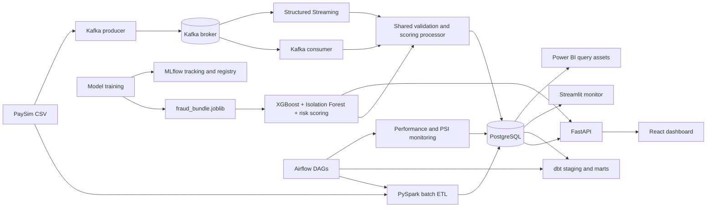
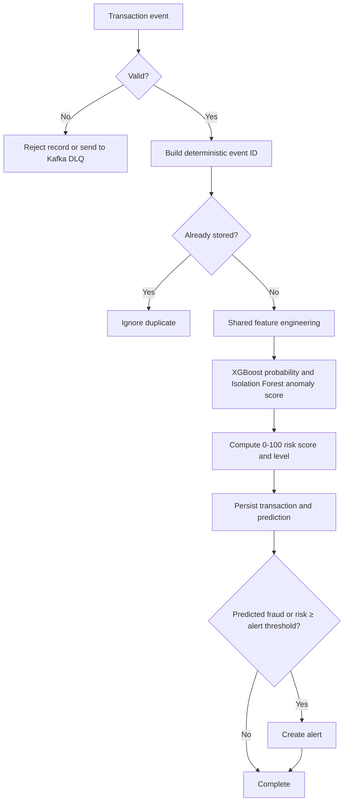

# Real-Time Fraud Detection & Intelligent Data Engineering Platform


An end-to-end fraud analytics platform for PaySim-style mobile money transactions. It combines batch and streaming data pipelines with machine-learning risk scoring, PostgreSQL storage, a FastAPI service, and interactive operational dashboards. The project demonstrates how ML inference, data quality, orchestration, monitoring, and user-facing tools can fit into one system.

> **Implementation status:** Core API, scoring, ETL, frontend, dbt models, and orchestration are implemented. `TEST_REPORT.md` records successful Linux-environment checks and explicitly lists integrations that were not verified. Docker Compose, a Kafka broker round trip, Power BI Desktop, and native Windows installation have not been verified. Model-training commands are documented as optional maintenance only; training is currently postponed.

## Contents

- [Project highlights](#project-highlights)
- [System architecture](#system-architecture)
- [Technology stack](#technology-stack)
- [Repository structure](#repository-structure)
- [Dataset](#dataset)
- [Machine-learning pipeline](#machine-learning-pipeline)
- [Data-engineering pipeline](#data-engineering-pipeline)
- [Backend API](#backend-api)
- [Frontend dashboard](#frontend-dashboard)
- [Monitoring and MLflow](#monitoring-and-mlflow)
- [Installation and setup](#installation-and-setup)
- [Environment variables](#environment-variables)
- [Running the application](#running-the-application)
- [Docker deployment](#docker-deployment)
- [Testing and verification](#testing-and-verification)
- [Security and reliability](#security-and-reliability)
- [Current limitations](#current-limitations)
- [Future enhancements](#future-enhancements)
- [Author and license](#author-and-license)

<a id="project-highlights"></a>
## ✨ Project highlights

| Capability | Status | What is present |
|---|---|---|
| Fraud prediction and hybrid risk scoring | Implemented | XGBoost probability combined with an Isolation Forest anomaly score |
| Batch transaction processing | Implemented | PySpark validation, deduplication, Parquet staging, and PostgreSQL ingestion |
| Real-time processing | Implemented; broker integration unverified | Kafka producer/consumer and an alternative Spark Structured Streaming path share a processor |
| Transaction and alert management | Implemented | API ingestion, search, filters, pagination, and alert status updates |
| Data transformations and orchestration | Implemented | dbt staging/marts and Airflow DAG definitions |
| Model and data monitoring | Implemented | Labeled performance reports, PSI drift reports, and pipeline-run records |
| Interactive analytics | Implemented | React operations console and a Streamlit monitor; Power BI query assets are included |

<a id="system-architecture"></a>
## 🏗️ System architecture

The same feature builder and scoring bundle are used across API, batch scoring, and streaming paths. PostgreSQL is the shared operational store for transactions, predictions, alerts, and monitoring records.



### Transaction processing workflow



The Kafka consumer uses manual offset commits after database work and dead-letter sends complete. Spark Structured Streaming uses checkpoints with the same idempotent database sink. These mechanisms are implemented; broker-based end-to-end behavior remains unverified in the documented environment.

<a id="technology-stack"></a>
## 🛠️ Technology stack

| Category | Technology | Purpose |
|---|---|---|
| API | FastAPI, Pydantic, Uvicorn | Validated prediction, transaction, alert, analytics, and monitoring endpoints |
| Machine learning | XGBoost, scikit-learn, pandas, NumPy | Fraud classification, baseline model, anomaly detection, and feature preparation |
| Data processing | PySpark, Apache Spark Structured Streaming, PyArrow | Batch ETL, file/Kafka streaming, and Parquet staging |
| Streaming | Apache Kafka, kafka-python | Transaction event publication, consumption, and dead-letter handling |
| Storage | PostgreSQL, SQLAlchemy, psycopg2 | Operational data, analytics views, alert state, and pipeline/model reports |
| Transformation and orchestration | dbt Core with dbt-postgres, Apache Airflow | Warehouse staging/marts, data checks, and scheduled workflows |
| Experiment tracking | MLflow | Experiment runs and optional XGBoost model registration |
| Web dashboard | React 18, Vite, Recharts | Interactive operational and analytics console |
| Monitoring UI | Streamlit | Database-backed transaction and risk monitoring |
| Packaging | Docker Compose | Local multi-service definitions and optional service profiles |
| Tests | pytest, Vitest, Testing Library | Python unit/integration/API checks and frontend tests |

<a id="repository-structure"></a>
## 📁 Repository structure

```text
.
├── backend/
│   ├── api/                   # FastAPI application, schemas, dependencies, routers
│   ├── src/
│   │   ├── common/            # Settings, database helpers, schema, logging
│   │   ├── data/              # Synthetic PaySim-schema generator and sample prep script
│   │   ├── etl/               # PySpark batch ETL and input validation
│   │   ├── ml/                # Training and shared feature engineering
│   │   ├── monitoring/        # Drift and model performance jobs
│   │   ├── scoring/           # Inference and batch scoring
│   │   └── streaming/         # Kafka producer/consumer and Spark stream
│   └── tests/                 # API, pipeline, monitoring, streaming, and UI tests
├── data/                      # Raw, sample, processed, and streaming data locations
├── db/
│   ├── migrations/            # Versioned PostgreSQL schema migrations
│   └── init.sql
├── dbt_project/               # Staging, intermediate, marts, macros, tests, profile
├── docker/                    # Application, frontend, and Airflow Dockerfiles; nginx config
├── docs/
│   ├── architecture.md
│   └── evidence/              # Existing test and verification logs
├── frontend/                  # React/Vite dashboard and Vitest tests
├── orchestration/dags/        # Batch pipeline and manual retraining DAGs
├── powerbi/                   # PostgreSQL queries, measures, theme, and PBIDS connection
├── scripts/                   # Migration and Power BI query validation utilities
├── streamlit_app/             # Streamlit monitoring dashboard
├── .env.example
├── docker-compose.yml
├── requirements.txt
├── requirements-dbt.txt
├── TEST_REPORT.md
└── README.md
```

The model bundle and datasets are local artifacts and are excluded from Git by `.gitignore`; their availability depends on the checkout environment.

<a id="dataset"></a>
## 📊 Dataset

The pipeline accepts the PaySim transaction schema. The expected raw CSV path is `data/raw/paysim.csv` (also configurable with `PAYSIM_CSV`). Required PaySim columns include `step`, `type`, `amount`, `nameOrig`, `oldbalanceOrg`, `newbalanceOrig`, `nameDest`, `oldbalanceDest`, and `newbalanceDest`; `isFraud` and `isFlaggedFraud` are optional labels/metadata in applicable inputs.

`isFraud` is the dataset ground-truth label. Live events can omit it. `isFlaggedFraud` is stored but is not used as a model feature. The repository includes a synthetic PaySim-schema generator at `backend/src/data/generate_paysim.py`; its default output is `data/raw/paysim.csv`. **Running the generator writes a dataset**, so it is intentionally not part of setup instructions. A chunk-based preparation script, `backend/src/data/create_small_dataset.py`, reads `data/raw/paysim_full.csv` and writes sampled train, validation, and test CSVs under `data/processed/`; it is also not run automatically.

No real PaySim CSV is committed. Obtain the dataset through its source under your own access terms, then place it at the configured path. The repository does not provide a download URL. Transaction labels are simulated, and fraud is a minority class; results depend strongly on the dataset and sampling strategy. Statistics in the existing test report refer to generated synthetic data and must not be read as real PaySim statistics.

<a id="machine-learning-pipeline"></a>
## 🤖 Machine-learning pipeline

- **XGBoost classifier:** primary fraud probability model.
- **Logistic Regression:** comparison baseline during training.
- **Isolation Forest:** anomaly signal normalized against bounds saved with the trained bundle.
- **Shared features:** `backend/src/ml/features.py` builds transaction and balance-error features for training and serving, reducing train/serve skew.
- **Decision and risk:** the fraud prediction compares XGBoost probability to the model bundle's validation-selected threshold. Risk combines classifier probability and normalized anomaly score:

  ```text
  risk_score = round(100 × (0.85 × fraud_probability + 0.15 × anomaly_score), 2)
  ```

- **Risk bands:** `LOW` < 30, `MEDIUM` < 60, `HIGH` < 80, and `CRITICAL` ≥ 80.
- **Alerts:** a new alert is created when the model predicts fraud **or** the risk score meets `ALERT_RISK_THRESHOLD` (default 80).
- **Model bundle:** `models/fraud_bundle.joblib` contains the classifier, anomaly detector and normalization bounds, threshold, feature list, reference profile, metrics, and model version. The scorer loads this bundle for inference.
- **Tracking:** the training implementation logs runs and metrics to MLflow and attempts to register the primary model under `MODEL_NAME`.

Training uses a time-based split and chooses a threshold on validation data. Metrics from `TEST_REPORT.md` are for a synthetic 100,000-row generated dataset only. Model training is postponed; do not run the training command as part of normal setup. This checkout has a local bundle, but the `models/` directory is Git-ignored, so a fresh clone must obtain an approved bundle from its project owner or trusted artifact storage before inference.

<a id="data-engineering-pipeline"></a>
## 🔄 Data-engineering pipeline

### Batch and streaming paths

1. **Batch ETL:** PySpark validates required columns, numeric ranges, transaction types, and labels; records rejects with reasons; derives deterministic event IDs; removes duplicates; stages Parquet output with source manifests; and ingests records into PostgreSQL.
2. **Kafka path:** the producer publishes JSON events. The consumer validates and deduplicates through the shared processor, scores records, persists transactions/predictions/alerts, sends malformed or invalid records to the configured DLQ, and commits polled offsets after database and DLQ work.
3. **Spark streaming path:** Structured Streaming can read Kafka or JSON-lines files and uses checkpoints and the shared processor. The file source and checkpoint recovery have evidence in `TEST_REPORT.md`; the Kafka source needs broker/package integration verification.
4. **Warehouse:** dbt defines staging and intermediate views plus analytics tables for transactions, daily fraud, risk distribution, transaction types, customers, and merchants. Generic and custom SQL tests validate key relationships and business properties.
5. **Orchestration:** `fraud_batch_pipeline` sequences input validation, ETL, batch scoring, performance monitoring, dbt run/test, and drift monitoring. `fraud_model_retrain` is manual-only so scheduled runs do not replace the active model bundle implicitly.

The current Spark ETL runs locally (`local[*]`) and caps driver memory at 1500 MB. It is a local development pipeline, not a configured distributed Spark cluster.

<a id="backend-api"></a>
## 🔌 Backend API

The FastAPI application is defined in `backend/api`. Interactive OpenAPI documentation is available at `/docs` and `/redoc` when the API is running. If `API_KEY` is non-empty, endpoints require the `X-API-Key` header. The health endpoint reports database/model readiness; inference requires a loadable model bundle.

| Method | Endpoint | Description |
|---|---|---|
| `GET` | `/health` | Database and model health |
| `POST` | `/predict` | Score one transaction without storing it |
| `POST` | `/predict/batch` | Score 1–1,000 transactions without storing them |
| `POST` | `/transactions` | Score and persist a transaction; idempotent by event ID |
| `GET` | `/transactions` | Search, filter, sort, and paginate transactions |
| `GET` | `/transactions/{event_id}` | Retrieve a transaction and its prediction |
| `GET` | `/alerts` | List alerts; optionally filter by status |
| `PATCH` | `/alerts/{alert_id}` | Update alert status |
| `GET` | `/analytics/overview` | Operational KPI and risk/alert summaries |
| `GET` | `/analytics/timeseries` | Daily or hourly analytics series |
| `GET` | `/analytics/by-type` | Transaction type summaries |
| `GET` | `/analytics/top-risk-accounts` | Accounts with observed fraud, ordered by counts/volume |
| `GET` | `/model/metrics` | Active model metadata, metrics, confusion matrix, and history |
| `GET` | `/pipeline/runs` | Recent pipeline runs and status summary |
| `POST` | `/monitoring/drift/run` | Calculate and persist PSI for a recent transaction window |
| `GET` | `/monitoring/drift` | Latest PSI status per feature |

### Example: ingest and score

```powershell
$body = @{
  step = 300
  type = "TRANSFER"
  amount = 250000
  name_orig = "C111"
  old_balance_org = 250000
  new_balance_org = 0
  name_dest = "C222"
  old_balance_dest = 0
  new_balance_dest = 0
} | ConvertTo-Json

Invoke-RestMethod -Method Post -Uri "http://localhost:8000/transactions" `
  -ContentType "application/json" -Body $body
```

The `201` response follows this shape (values vary with the active model and input):

```json
{
  "fraud_probability": 0.82,
  "anomaly_score": 0.74,
  "risk_score": 80.8,
  "risk_level": "CRITICAL",
  "is_fraud_pred": true,
  "model_version": "<active-model-version>",
  "event_id": "<deterministic-event-id>",
  "duplicate": false,
  "alert_created": true
}
```

Transaction input validation rejects negative amounts/balances and invalid transaction types. Database failures return a JSON `503`; request validation errors return `422`; missing/invalid API keys return `401` when API-key protection is enabled.

<a id="frontend-dashboard"></a>
## 📈 Frontend dashboard

The React/Vite console contains six routes, all backed by API responses:

| Page | Implemented view |
|---|---|
| Overview | Transaction, volume, fraud, and alert KPIs; daily trend, risk distribution, and transaction-type summaries |
| Transactions | Search and filter controls, sortable/paginated list, and transaction detail drawer |
| Alerts | Alert list and status actions for investigation, confirmation, or dismissal |
| Analytics | Time series, transaction-type metrics, and high-risk account summaries |
| Model | Active model performance/history, confusion matrix, and drift status/action |
| Pipelines | Pipeline run history, failures, and status summary |

Vite proxies `/api/*` to the FastAPI server in development and removes the `/api` prefix. The repository also includes Power BI SQL queries, measures, a theme, and a PBIDS connection file, but no `.pbix` dashboard. The query checks are documented as passing; Power BI Desktop connectivity and report rendering are unverified. No screenshots are included.

<a id="monitoring-and-mlflow"></a>
## 📉 Monitoring and MLflow

- **MLflow:** training records experiments, parameters, metrics, and model artifacts; model registry use is optional. The UI can be launched against the configured tracking store.
- **Drift:** PSI compares seven engineered transaction features with the training reference profile stored in the model bundle. The implementation labels PSI `< 0.10` as `OK`, `< 0.25` as `WARN`, and `≥ 0.25` as `DRIFT`; windows below 200 current or reference rows are marked `INSUFFICIENT_DATA`.
- **Performance:** a monitoring job evaluates persisted predictions for transactions with known labels and stores metrics/confusion counts in `model_metrics`.
- **Pipeline health:** jobs record row counts, status, and errors in `pipeline_runs`; the API and dashboard expose these records.

Drift is a feature-distribution signal, not proof of degraded model quality. Performance evaluation requires labeled outcomes, and small samples can be inconclusive. MLflow registry behavior and external integrations should be validated in the target environment.

<a id="installation-and-setup"></a>
## ⚙️ Installation and setup

The commands below use Windows PowerShell and a locally installed PostgreSQL server. Native Windows/PySpark installation has not been verified; WSL2 or Docker may be needed for Spark dependencies. Do not run model training during setup.

### Prerequisites

- Python 3.12
- Node.js and npm (the project test report used Node 22)
- PostgreSQL 16 or compatible
- Java 17 or 21 for PySpark tasks
- An approved model bundle at `models/fraud_bundle.joblib` before inference

Kafka, Airflow, dbt transformations, Streamlit, and MLflow UI are optional for running the API and React console. Their supporting services/dependencies are needed only for those workflows.

### Create the environment and database

```powershell
git clone <repository-url>
Set-Location fraud-detection-platform

py -3.12 -m venv .venv
Set-ExecutionPolicy -Scope Process -ExecutionPolicy Bypass
.\.venv\Scripts\Activate.ps1
python -m pip install --upgrade pip
pip install -r requirements.txt

Copy-Item .env.example .env
# Edit .env and set POSTGRES_PASSWORD to a local database password.

# Run these using a PostgreSQL account with permission to create roles/databases.
psql -U postgres -c "CREATE USER fraud_user WITH PASSWORD 'replace-with-your-password';"
psql -U postgres -c "CREATE DATABASE fraud_db OWNER fraud_user;"

python scripts/migrate.py
```

If the role or database already exists, use the existing credentials in `.env` instead of creating them again. `scripts/migrate.py` applies the checked-in SQL migrations.

### Restore the inference model

`models/` is Git-ignored. Before starting the API, restore the project-approved `fraud_bundle.joblib` from the artifact source supplied by the project owner or your own trusted backup and place it under `models/` (or configure `MODEL_DIR`). No public download URL is defined in this repository. Without the bundle, the API can start in degraded mode, but prediction endpoints return `503`. Do not substitute an unreviewed model. Training is not required or recommended for setup.

### Install frontend dependencies

```powershell
Set-Location frontend
npm ci
Set-Location ..
```

<a id="environment-variables"></a>
## 🔐 Environment variables

`.env.example` defines the five PostgreSQL variables below. The application and Compose files also support these optional settings; defaults shown are from application configuration unless marked as Compose defaults.

| Variable | Purpose | Example/default |
|---|---|---|
| `POSTGRES_DB` | Database name | `fraud_db` |
| `POSTGRES_HOST` | Database host | `localhost` (Compose: `postgres`) |
| `POSTGRES_PASSWORD` | Required database password | Set a private local value |
| `POSTGRES_PORT` | Database port | `5432` |
| `POSTGRES_USER` | Database role | `fraud_user` |
| `API_HOST` | API bind host for application settings | `0.0.0.0` |
| `API_PORT` | API port setting | `8000` |
| `API_KEY` | Optional shared API key; sent as `X-API-Key` | Empty means API-key check is disabled |
| `CORS_ORIGINS` | Comma-separated allowed browser origins | `http://localhost:5173,http://127.0.0.1:5173` (Compose supplies frontend origins) |
| `ALERT_RISK_THRESHOLD` | Risk-score threshold for opening an alert | `80` |
| `LOG_LEVEL` | Application log level | `INFO` |
| `KAFKA_BOOTSTRAP_SERVERS` | Kafka broker list | `localhost:9092` (Compose: `kafka:19092`) |
| `KAFKA_TOPIC` | Input transaction topic | `transactions` |
| `KAFKA_DLQ_TOPIC` | Dead-letter topic | `transactions.dlq` |
| `KAFKA_GROUP_ID` | Consumer group | `fraud-scorer` |
| `SPARK_CHECKPOINT_DIR` | Structured Streaming checkpoints | `data/checkpoints` |
| `SPARK_SHUFFLE_PARTITIONS` | Spark shuffle partition count | `4` |
| `MODEL_DIR` | Directory containing the approved model bundle | `models` |
| `MODEL_NAME` | MLflow registered model name | `fraud-xgb` |
| `DATA_DIR` | Data root | `data` |
| `PAYSIM_CSV` | Source CSV path | `data/raw/paysim.csv` |
| `MLFLOW_TRACKING_URI` | MLflow tracking store | `sqlite:///./mlflow.db` (Compose: persistent SQLite under `/app/state`) |
| `MLFLOW_EXPERIMENT` | MLflow experiment name | `fraud-detection` |
| `VITE_API_BASE` | Frontend API base path | `/api` |
| `VITE_PROXY_TARGET` | Vite development proxy target | `http://localhost:8000` |
| `TEST_POSTGRES_DB` | Optional separate test database name | Set only for Python integration tests |

Compose additionally accepts published-port overrides such as `POSTGRES_PUBLISHED_PORT`, `KAFKA_PUBLISHED_PORT`, `API_PUBLISHED_PORT`, `FRONTEND_PUBLISHED_PORT`, `MLFLOW_PUBLISHED_PORT`, `STREAMLIT_PUBLISHED_PORT`, and `AIRFLOW_PUBLISHED_PORT`. Keep `.env` private and do not commit credentials.

<a id="running-the-application"></a>
## ▶️ Running the application

Start PostgreSQL using your local service manager. Then, from the repository root with the virtual environment active and `.env` configured:

### FastAPI and React

```powershell
python -m uvicorn backend.api.main:app --reload --port 8000
```

In a second PowerShell window:

```powershell
Set-Location frontend
npm run dev
```

Open the Vite URL printed in the terminal (configured port `5176`). API docs are at `http://localhost:8000/docs`.

### Optional processing and monitoring jobs

These commands run only when their dependencies and required inputs/services are available.

```powershell
# Batch ETL (requires data/raw/paysim.csv); then score stored, unscored rows
python -m backend.src.etl.batch_etl --input data/raw/paysim.csv
python -m backend.src.scoring.batch_score

# Kafka producer and consumer (requires reachable Kafka topics and the model bundle)
python -m backend.src.streaming.producer --rate 50 --limit 1000
python -m backend.src.streaming.consumer

# Spark Structured Streaming with JSON-lines input files
python -m backend.src.streaming.spark_stream --source files --input-dir data/stream_in

# Streamlit database monitor
streamlit run streamlit_app/app.py

# MLflow UI (requires full MLflow package; Compose service uses a persistent store)
mlflow ui --backend-store-uri sqlite:///./mlflow.db

# Create the dedicated dbt environment once from the repository root.
py -3.12 -m venv .venv-dbt
& .\.venv-dbt\Scripts\python.exe -m pip install -r requirements-dbt.txt

# dbt reads process environment variables directly, so export .env values first.
Set-Location dbt_project
Get-Content ..\.env | Where-Object { $_ -match '^\s*[^#\s][^=]*=' } | ForEach-Object {
  $name, $value = $_ -split '=', 2
  [Environment]::SetEnvironmentVariable($name.Trim(), $value.Trim(), 'Process')
}
& ..\.venv-dbt\Scripts\dbt.exe build --profiles-dir .
Set-Location ..

# Airflow DAG definitions are in orchestration/dags; configure Airflow separately.
```

The Kafka producer defaults to a bounded 1,000 events. `backend/src/streaming/spark_stream.py` accepts `--source kafka` or `--source files`, plus `--input-dir`, `--checkpoint`, `--once`, and `--trigger-seconds`. For dbt in a separate environment, install `requirements-dbt.txt`; Airflow's dependencies also have their own Dockerfile environment. If `API_KEY` is enabled, the React frontend does not attach it itself; use a trusted same-origin gateway that adds the header or keep the API private. The Airflow batch DAG is scheduled daily; the retraining DAG is unscheduled/manual.

<a id="docker-deployment"></a>
## 🐳 Docker deployment

`docker-compose.yml` defines PostgreSQL, Kafka and topic initialization, schema migration, FastAPI, the React/nginx frontend, and optional bootstrap, MLflow, Streamlit, Kafka streaming, Spark, dbt, and Airflow services. PostgreSQL and Kafka data, processed data, checkpoints, MLflow state, and Airflow state use named volumes. Published ports bind to loopback by default. Health checks are configured for PostgreSQL, Kafka, API, frontend, MLflow, and Airflow.

Docker execution and image builds have not been verified in the available evidence. The Compose configuration is intended for local development and uses single-node services; inspect it and supply `.env` values before use. The bootstrap profile requires both a source CSV and an existing model bundle. No setup step silently generates a dataset or trains/replaces the model.

```powershell
Copy-Item .env.example .env
# Edit .env and set the database password.
docker compose up -d postgres api frontend
docker compose ps
docker compose logs -f api

# Stop containers while preserving named volumes
docker compose down
```

Optional Compose profiles include `bootstrap`, `streaming`, `spark`, `analytics`, `airflow`, `mlflow`, and `streamlit`. For example, start the Kafka services with `docker compose --profile streaming up -d kafka kafka-init stream-consumer`, then run a bounded producer with `docker compose --profile streaming run --rm producer`. `docker compose down -v` removes named volumes and their data; use it only when that deletion is intended.

The `.dockerignore` excludes local data, models, MLflow state, and development artifacts from the build context. Compose bind-mounts data and model directories at runtime, so the approved model bundle must exist locally before starting inference services.

<a id="testing-and-verification"></a>
## 🧪 Testing and verification

`TEST_REPORT.md` and `docs/evidence/` contain the existing verification record. The report records 56 Python tests passed, 1 skipped, and 84% coverage in its Linux test environment; 8 frontend tests passed; a production frontend build passed; 6 Power BI SQL query checks passed; 6 dbt models and 19 dbt tests passed; and the Airflow batch DAG test passed. These are existing report results, not runs performed while editing this README.

```powershell
# Python unit/API/integration tests; integration tests need a separate test database.
pytest -q

# Frontend tests and production build
Set-Location frontend
npm test
npm run build
Set-Location ..

# dbt models and data tests; install requirements-dbt.txt and export .env values first.
Set-Location dbt_project
Get-Content ..\.env | Where-Object { $_ -match '^\s*[^#\s][^=]*=' } | ForEach-Object {
  $name, $value = $_ -split '=', 2
  [Environment]::SetEnvironmentVariable($name.Trim(), $value.Trim(), 'Process')
}
& ..\.venv-dbt\Scripts\dbt.exe build --profiles-dir .
Set-Location ..

# Power BI SQL checks against the configured PostgreSQL database
python scripts/check_powerbi_queries.py
```

The test report states that its Python integration tests used a separate `fraud_test` database. Configure `TEST_POSTGRES_DB` or create that database before running them; never point destructive test setup at a database containing data you need. Native Windows, Docker builds, a live Kafka broker, Spark's Kafka source, Power BI Desktop, and real-browser layout remain unverified.

<a id="security-and-reliability"></a>
## 🔐 Security and reliability

**Implemented:** configuration through environment variables; Pydantic request validation and numeric bounds; optional API-key checking with constant-time comparison; configurable CORS origins; parameterized SQL values and whitelisted sort fields; structured application logging that avoids logging SQL parameters; schema migrations and database constraints; deterministic event IDs and conflict-safe inserts; retry handling; Kafka dead-letter routing and manual offset commits; and Spark checkpoints.

**Before production use:** configure TLS and secret management, identity-backed authentication and authorization, database backup/restore, retention and privacy policies, hardened network access, and operational alerting. Compose defaults bind published ports to loopback, but this alone is not a production security boundary. No per-user roles or built-in email/Slack alert delivery are implemented.

<a id="current-limitations"></a>
## ⚠️ Current limitations

- The local model bundle is not tracked by Git. A fresh checkout needs a trusted approved artifact before inference; model training is postponed.
- Existing reported model metrics use synthetic PaySim-schema data. They do not establish performance on real PaySim or production transactions.
- Fraud is a minority class, and PaySim labels are simulated; threshold selection and metric stability depend on representative data and enough positive cases.
- Kafka broker communication, DLQ delivery, Docker Compose runtime/builds, native Windows installation, Power BI Desktop, and real-browser rendering have not been verified in the cited report.
- Spark ETL runs locally and has only been exercised at limited scale; it is not configured for a distributed cluster.
- Airflow DAG execution was tested in-process; a running scheduler and multi-worker deployment were not verified.
- The React tests use a jsdom environment and API fixtures/test setup; browser visual review is not documented.
- Production authentication, role-based authorization, and alert notifications are not included.

<a id="future-enhancements"></a>
## 🚀 Future enhancements

These are possible next steps, not implemented features:

- Add SHAP explanations and account-level velocity/history features.
- Add investigation workflows and email/Slack/webhook alert delivery.
- Add identity-provider integration and role-based access control.
- Add Prometheus/Grafana metrics and CI workflows for Python, dbt, and frontend checks.
- Add model promotion/rollback workflows around an MLflow registry.
- Add Kafka Schema Registry and deploy Spark against a managed cluster.
- Validate and calibrate models using representative, properly governed transaction data.
- Package and deploy the services to a cloud environment with production-grade storage and secrets.


## 👨‍💻 Author

**Shahwaz Azam**  
B.Tech – Computer Science & Engineering (Data Science), 2026

Interested in building practical solutions in:

- Artificial Intelligence & Machine Learning
- Data Engineering and Big Data Processing
- Generative AI and Intelligent Applications
- Backend Development and Distributed Systems

### Connect with Me

<p align="left">
  <a href="https://github.com/azamshahwaz">
    
  </a>
  <a href="https://www.linkedin.com/in/shahwaz-azam">
    
  </a>
</p>

### About This Project

This project demonstrates the integration of Machine Learning and Data Engineering technologies to build an end-to-end fraud detection platform.

It was developed to explore real-world engineering concepts such as transaction processing, predictive modeling, real-time streaming, distributed data processing, workflow orchestration, and analytical visualization.

---

## 📄 License

No open-source license has currently been declared for this repository.

Unless a license is added, the project remains subject to the default copyright protections. Please contact the author before redistributing or reusing the source code beyond applicable legal permissions.

If you intend to make this project open source, consider adding an appropriate license file, such as the MIT License.

---

<p align="center">
  <b>Built with Python, Machine Learning, and Data Engineering.</b>
  <br/>
  <i>Turning transaction data into actionable fraud intelligence.</i>
</p>
