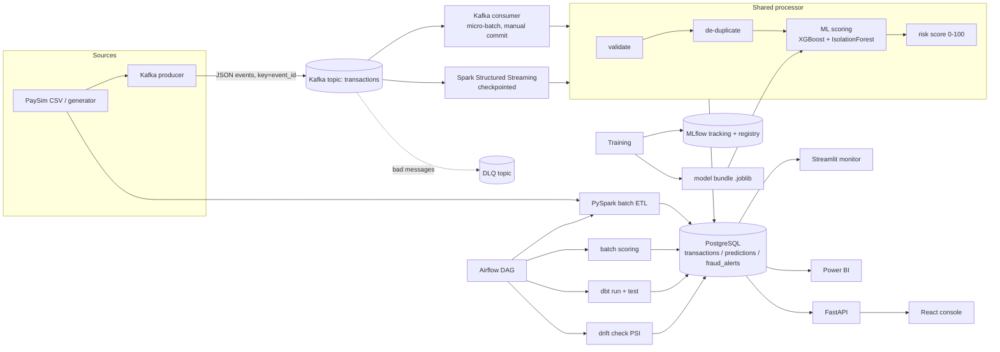

# Architecture

## Data flow (real-time path)
1. `producer` replays transactions into Kafka (key = deterministic `event_id`).
2. `consumer` **or** `spark_stream` reads micro-batches. Both call `src/streaming/processor.py`.
3. Records are validated (bad ones → DLQ), de-duplicated inside the batch, inserted with `ON CONFLICT DO NOTHING`.
4. The scorer computes fraud probability (XGBoost), anomaly score (IsolationForest) and
   `risk_score = 100 × (0.85·p + 0.15·anomaly)`; LOW <30, MEDIUM <60, HIGH <80, CRITICAL ≥80.
5. Predictions are upserted; an alert is opened when `p ≥ threshold` or `risk_score ≥ ALERT_RISK_THRESHOLD`.
6. API / React / Streamlit / Power BI read PostgreSQL. Nothing is hard-coded.

## Reliability design
| Concern | Mechanism |
|---|---|
| Duplicate events | deterministic `event_id` (sha256) + `ON CONFLICT DO NOTHING`; same id logic in Python and Spark |
| Retries | DB calls retried with exponential backoff; consumer retries a batch 5× and only then fails *without committing offsets* |
| Crash recovery | Kafka: offsets committed after DB write (at-least-once + idempotent sink). Spark: checkpoint directory |
| Bad data | validation in ETL (reject reasons) and streaming (DLQ) |
| Pipeline failure visibility | `pipeline_runs` table (status, rows in/out, error), shown in the React "Pipelines" page |
| Train/serve skew | one `build_features()` used by training, API, batch and streaming |
| Leakage | time-based train/val/test split on `step`; threshold chosen on validation only |
